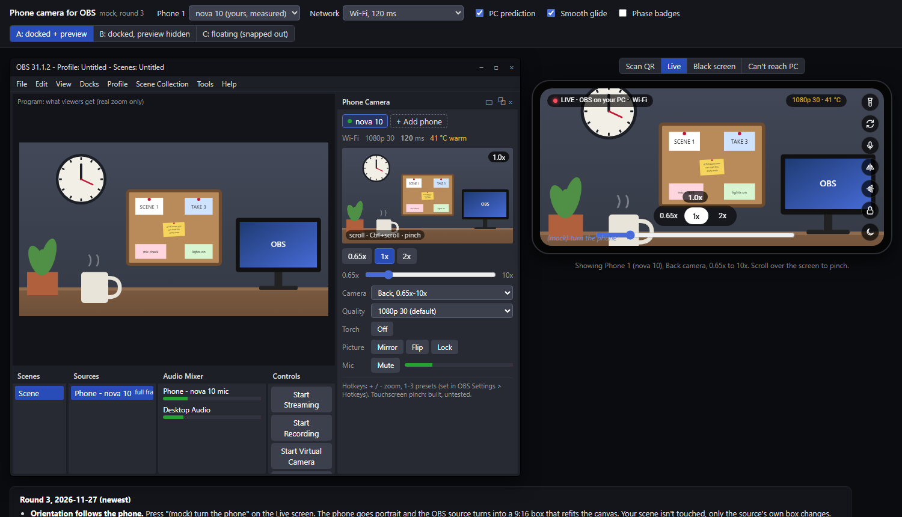

# Rely-A-Cam

**A free OBS webcam plugin, Windows only for now.** A standalone app that works without OBS is
coming in 0.2.0. The gesture module is experimental and entirely optional.

Use your Android phone as a camera in OBS Studio, for free. Zoom stays in sync on both screens:
pinch on the phone or scroll in OBS, and the phone's camera follows.

- **Free, and it stays free.** No account, no cloud, no ads, no tracking, no watermark and no
  paywall. The phone talks to your PC directly.
- **Synced zoom.** You can zoom from the phone or from OBS, using the mouse wheel, a touchpad
  pinch, the ruler, presets or hotkeys. Presets come from your phone's own lenses, including
  ultrawide lenses that other apps can't see.
- **Camera controls from either side:** tap to focus with a brightness slider, hold to lock focus
  and exposure, white balance presets, and full-resolution snapshots saved on the PC while the
  stream keeps going.
- **Framing help:** a rule-of-thirds grid on the phone, the dock or the OBS output (each on its
  own), and a level line on the phone.
- **The phone's mic in other apps:** one click sets up VB-Audio Virtual Cable, and the phone
  becomes Windows' default mic while its mic is on.
- **Pair by QR.** Scan the code in OBS's Phone Camera dock. Reconnects on its own after that.
- **Wi-Fi, phone hotspot or USB.**
- **Up to 4K**, if the phone can encode it. Only modes the phone really supports are offered.
- Front and back cameras, torch, the phone's mic as an OBS audio source, mirror, flip, and
  orientation that follows the phone (or stays locked).
- **Several phones at once**, each as its own OBS source.

*Pictures in this README come from the design mockup (`docs/mock.html`).*

## Get it

Everything is on the [latest release](https://github.com/uukjtisa/rely-a-cam/releases/latest):

| On | Download | Then |
|---|---|---|
| Windows PC with OBS 31+ | `RelyACam-Setup-<version>.exe` | Run it. Open OBS; the **Phone Camera** dock shows a QR. |
| Android phone (8.0+) | `RelyACam-<version>.apk` | Install it, open it, scan the QR. |
| Optional, experimental | `RelyACamGestures-Setup-<version>.exe` | Hand and face gestures and memes for your phone cameras (a 49 MB download). Rely-A-Cam works fully without it. |

Only grabbed one of the two? Each half gets you the other in one step:

- **From OBS:** in the dock, click **+ Add phone**, then **No app on the phone?** Scan that QR
  with the phone's normal camera to download the app straight from your PC (no internet needed).
  Or plug the phone in by USB and click **Install app over USB**.
- **From the phone:** tap **Get PC plugin** for the link, then share it or copy it.

[SETUP.md](SETUP.md) walks through it with pictures, and covers what to do when a phone can't
connect.

## How it works

The phone encodes H.264 or HEVC (and AAC for the mic) with its hardware encoder and sends it
over one TCP connection to the plugin, which decodes it with the FFmpeg that OBS already ships.
The phone owns the camera and its zoom: OBS sends requests, and both screens show the value
the phone reports. The full wire format is in [protocol/PROTOCOL.md](protocol/PROTOCOL.md).

## Build it yourself

| Half | Needs | Command |
|---|---|---|
| Phone app | Android SDK, JDK 17+ | `cd android && ./gradlew :app:assembleDebug` |
| OBS plugin | Visual Studio 2022, CMake 3.28+ | `cd obs-plugin && cmake --preset windows-x64 && cmake --build build_x64 --config RelWithDebInfo` |
| Installer + APK | the above, and Inno Setup | `scripts/package.ps1` |

The first CMake configure downloads the OBS sources, obs-deps and Qt that the plugin builds
against.

## Licences

- The OBS plugin (`obs-plugin/`) is **GPL-2.0-or-later**, as it links against libobs.
- The phone app (`android/`) is **GPL-3.0**.
- The QR encoder in the plugin is Project Nayuki's qrcodegen (MIT).
- The phone's QR reader uses ZXing (Apache-2.0).
- The installer ships Google's `adb` (Apache-2.0) for USB setup.

By Niccc2007.
