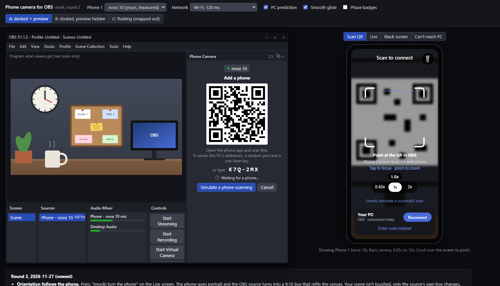
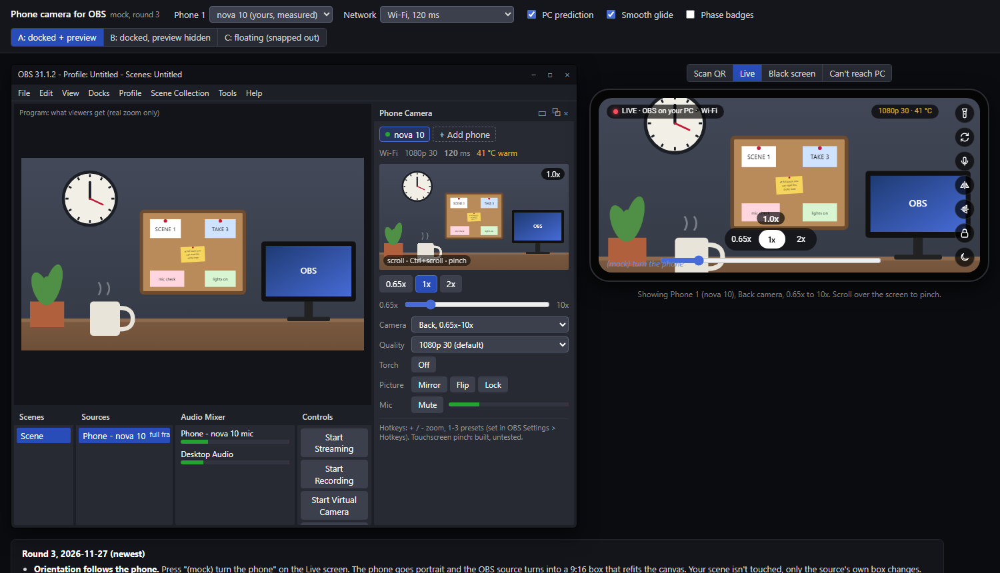
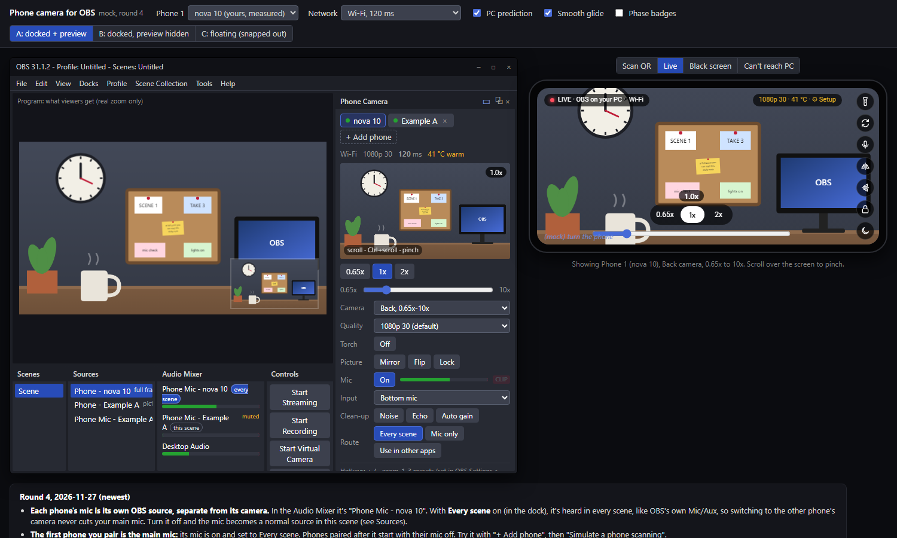
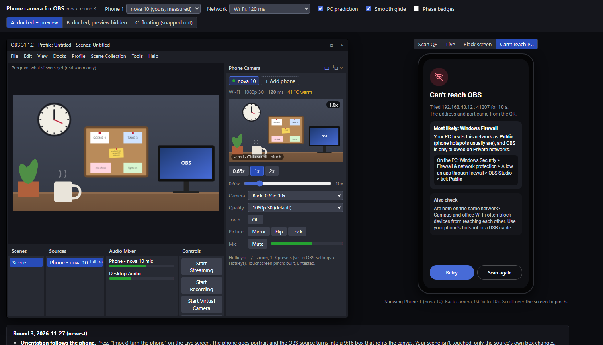

# Setting up Rely-A-Cam

This takes about two minutes. You need a Windows PC with **OBS Studio 31 or newer**, and an
**Android phone (8.0 or newer)**.

*Pictures here come from the design mockup, so the real app may differ slightly.*

## 1. On the PC: run the installer

1. From the [latest release](https://github.com/uukjtisa/rely-a-cam/releases/latest), download
   `RelyACam-Setup-<version>.exe` and run it.
2. If OBS is open, the installer offers to close it, because the plugin can't be replaced while
   OBS runs.
3. It also lets phones through Windows Firewall. Accept the admin prompt: without that rule,
   phones on a hotspot or a "Public" network can't reach OBS.
4. Open OBS. A **Phone Camera** dock appears. If you don't see it, use **Docks > Phone Camera**.

## 2. On the phone: get the app

Pick whichever is easiest:

- **From your PC, no internet needed:** in the dock, click **+ Add phone**, then
  **No app on the phone?** Scan that QR with the phone's normal camera, and the APK downloads
  straight from OBS.
- **Over USB:** plug the phone in and click **Install app over USB**. This needs USB debugging
  (see [USB](#usb) below).
- **From the release page:** download `RelyACam-<version>.apk` on the phone.

Android asks once to allow installs from your browser or file manager. Allow it, then install.

## 3. Pair: scan the QR

In OBS, click **+ Add phone**. Open Rely-A-Cam on the phone and point it at the QR.

- The scanner can zoom (pinch or the preset chips), focus (tap) and use the torch, which helps
  with a small or dim screen.
- Camera can't see the screen? Type the 6-character code shown under the QR. Tap
  **Enter code** on the phone.

Once the phone connects, a **Phone** source is added to your current scene, fitted to the
canvas. Nothing else in your scenes changes.

## 4. Use it

- **Zoom from OBS:** scroll over the dock preview, pinch on a touchpad, drag the slider, click a
  preset, or press `+`, `-` or `1`-`9` with the preview focused. You can also assign hotkeys in
  **Settings > Hotkeys**, listed under the phone's source.
- **Zoom from the phone:** pinch on the screen, use the preset chips, or drag the ruler.
- **Turn the phone** and the OBS source turns with it. **Lock** keeps the current shape.
- **Mirror**, **Flip**, **Torch**, **Mic** and the camera switch work from both sides.
- **Quality:** pick a mode in the dock or on the phone (**Setup** on the phone). You only see
  modes the phone supports. 1080p30 is the default.
- **Black screen** on the phone saves battery and heat while streaming. Tap to wake.
- **Stop** on the phone, or its notification, turns the camera and mic off at once.

The phone remembers this PC. Next time, open the app and it reconnects by itself. OBS
remembers each phone's camera, zoom (per camera), quality, mic, mirror, flip and lock, and restores them.

## The phone's mic

Each phone's mic is its own source in OBS, **Phone Mic - <phone>**, separate from its camera. So
one phone can be your main mic while you switch to another phone's camera.

- **The first phone you pair is the main mic.** Its mic is on and set to **Every scene**: it's
  heard in every scene, like OBS's own Mic/Aux, and switching scenes or cameras never cuts it.
- **Phones paired after it start with their mic off**, as a source in the current scene. Turn it
  on in the dock (or on that phone) if you want it.
- **Every scene** off puts the mic into the current scene as a normal source. On takes it out of
  your scenes again, so it's never heard twice.
- **Input:** pick which of the phone's mics to use. Phones list their built-in mics (often a
  bottom and a back one). A wired, USB or Bluetooth mic shows up once it's connected to the phone.
  Bluetooth mics are built in but haven't been tested on a real headset yet.
- **Clean-up:** **Noise** cuts steady hiss and hum, **Echo** removes sound from a speaker near the
  phone, and **Auto gain** evens out loud and quiet. You only see the ones that phone has.
- **The meter** shows the phone's level as it arrives. **CLIP** lights when it's too loud: move
  the phone back, or turn on Auto gain.
- **Mic only** turns the phone's camera off and keeps the mic. It saves battery and heat when a
  phone is only there to listen.
- On the phone, all of this is under **Setup** (the rail button, or tap the quality line).
- Volume, filters (noise gate, compressor), monitoring and sync offset are OBS's own: use the
  Audio Mixer, as with any mic.

### Use the phone mic in Chrome, Discord or Zoom

Windows can only see an OBS source as a microphone through a virtual audio cable.

1. Install the free [VB-Audio Virtual Cable](https://vb-audio.com/Cable/), then restart the PC.
2. In the dock, select the phone and turn on **Use in other apps**.
3. In Chrome, Discord or Zoom, pick **CABLE Output** as the microphone.

This plays the mic into the cable through OBS's audio monitoring. While it's on, anything else
you set to monitor in OBS goes into the cable too, not to your headphones. Turning it off gives
OBS its old monitoring device back. If the cable isn't installed, the button opens its download
page instead.

## When a phone can't connect

The phone names the likely cause. The usual ones:

1. **Windows Firewall.** A hotspot or new Wi-Fi is often a "Public" network, which blocks
   phones. Click **Allow phones** in the dock (it appears only when the rule is missing), or run
   the installer again.
2. **Different networks.** The phone must be on the same Wi-Fi as the PC, or the PC must be on
   the phone's hotspot. Guest and campus networks often block devices from seeing each other.
   Use the hotspot or USB instead.
3. **OBS isn't open.** The plugin only listens while OBS runs.

## USB

USB works without any network, and has the lowest delay.

1. On the phone, turn on **Developer options**: Settings > About phone, then tap **Build number**
   seven times.
2. In Developer options, turn on **USB debugging**.
3. Plug in and accept the "Allow USB debugging?" prompt on the phone.
4. In the dock, click **USB**. The app opens on the phone and connects through the cable.

## Updates

Both halves check the release page for updates. OBS shows **Update to v…** in the dock, and the
phone shows a banner. Update both, since a release always covers the pair.

## Uninstall

- **PC:** Windows Settings > Apps > "Rely-A-Cam for OBS". This also removes the firewall rules.
- **Phone:** uninstall the app as usual.
